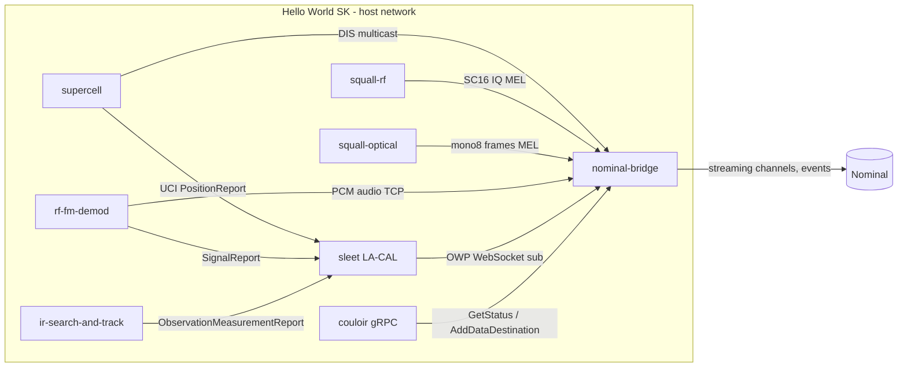

# AMS GRA Hello World SK → Nominal Integration

Streams every capturable output of the Open Arsenal **AMS GRA Hello World Starter Kit**
into [Nominal](https://nominal.io) live, and organizes it into a reviewable data model:
datasets, per-platform assets, runs, events, checklists, workbooks, and synced sensor
video. Built so AMS GRA users can put their own sensors into the simulation and analyze
the outputs alongside real sensor test data in one place.

The sim itself is not in this repo. Instantiate it from
[open-arsenal/ams-gra/hello-world-sk/getting-started](https://gitlab.com/open-arsenal/ams-gra/hello-world-sk/getting-started)
(this repo's `compose.yaml` is a Docker translation of that bundle's podman deployment,
with the Nominal bridge added).

## What gets captured

See [CAPTURE_MATRIX.md](CAPTURE_MATRIX.md) for the full table: every output in the kit's
`docs/ports.md` registry, how it lands in Nominal, what raw form is preserved, and the
handful of interfaces that are deliberately not captured (with reasons).

Summary:

| Stream | Live Nominal form | Raw preservation |
|---|---|---|
| DIS EntityState multicast (5 Hz truth) | Per-entity position/velocity/attitude channels + events | Verbatim PDU binary log |
| UCI over Sleet OWP (12 topics) | Typed channels per message family + state-transition events | Verbatim JSONL log |
| Squall IR MEL frames (mono8 320x200 @ 8 fps) | Frame-statistic channels + H.264 video channel | 4 fps raw frame ring |
| Squall RF MEL IQ (SC16, 2.048 Msps @ 915 MHz) | Level/clip/spectral channels + spectrogram waterfall video channel | 2 s SC16 snapshots + sidecars every 5 min |
| FM demod audio (S16LE 32 kHz) | Level/activity channels | Rolling + segmented WAVs |
| Prometheus metrics (6 services) + Couloir gRPC status | Observability channels, mode-change events | n/a (lossless in channels) |

## Architecture



Key integration mechanics:

- **OWP subscriber**: the bridge INITs against Sleet as its own authorized service
  (`sleet-services.d/nominal-bridge.toml`, bind-mounted into the sleet container) and
  subscribes to all 12 mission topics. No component is modified.
- **Raw MEL taps**: the bridge registers itself as a *second* UDP data destination on
  both Squall pipelines via the Couloir gRPC `AddDataDestination` call, so it receives a
  full copy of the raw sensor streams without interfering with the skills.
- **Streaming ingest**: `nominal` Python SDK write streams, one per dataset, ~500
  points/s total in the default scenario.

## Quickstart

Prerequisites: the Hello World SK images (public GitLab registry), Docker (or adapt to
podman), Python 3.11+ with `nominal` + `nominal-api`, `ffmpeg` for the video renderers,
and a Nominal profile (`nominal` CLI or `~/.config/nominal/config.yml`).

```bash
pip install -U nominal nominal-api

# 1. Create the Nominal resources (datasets, mission + per-platform assets, run)
#    and write RIDs + credentials into .env for docker compose:
python setup_nominal.py <your-nominal-profile>

# 2. Launch the sim + bridge:
docker compose up -d

# 3. Watch data arrive (channels appear in the catalog within ~2 minutes):
docker logs -f nominal-bridge

# 4. Build the review workbook and health checklist:
python build_workbook.py
python build_checklist.py --execute   # bounds nothing; executes against the run in .env

# 5. After capturing for a while, render + ingest sensor video and attach raw captures:
python render_ir_video.py <profile> $NOMINAL_DS_SENSOR
python render_waterfall.py <profile> $NOMINAL_DS_SENSOR
python attach_raw_captures.py <profile> $NOMINAL_RUN_RID
```

Notes:

- `checklist.execute` requires a bounded run; end the run first
  (`run.update(end=...)`) or let `build_checklist.py --execute` report the error and
  bound it manually.
- On macOS Docker Desktop, enable host networking; the squall containers run as uid
  1000 and need the shared socket volume writable (`chmod 0777` once, see compose).
- The default scenario's `mission.route-plan` topic never publishes (the kit's own
  sleet service authorization for supercell omits it); the bridge subscribes anyway.

## Repository layout

| Path | Purpose |
|---|---|
| `compose.yaml` | Full sim + bridge deployment (Docker translation of the kit bundle) |
| `bridge/` | The nominal-bridge container: all seven taps + streaming + raw capture |
| `sleet-services.d/nominal-bridge.toml` | OWP service authorization for the bridge |
| `setup_nominal.py` | Creates datasets, mission + per-platform assets, tag scopes, run; writes `.env` |
| `build_workbook.py` | 5-tab live review workbook (2D + 3D geo, truth vs perception, RF/IR chains, C2 health) |
| `build_checklist.py` | 8-check mission health checklist + execution to a data review |
| `render_ir_video.py` | Raw IR frames → H.264 → Nominal video channel (true frame timestamps) |
| `render_waterfall.py` | IQ spectrogram waterfall → H.264 → Nominal video channel |
| `attach_raw_captures.py` | Attaches raw SC16/DIS/UCI/audio/IR captures to the run |
| `CAPTURE_MATRIX.md` | Authoritative output-by-output capture table |

## License

Apache-2.0. `bridge/squall_rf.proto` and `bridge/squall_ir.proto` are copied from
[open-arsenal/ams-gra/hello-world-sk/sensors/squall](https://gitlab.com/open-arsenal/ams-gra/hello-world-sk/sensors/squall)
(Apache-2.0) to generate the Couloir gRPC client.
