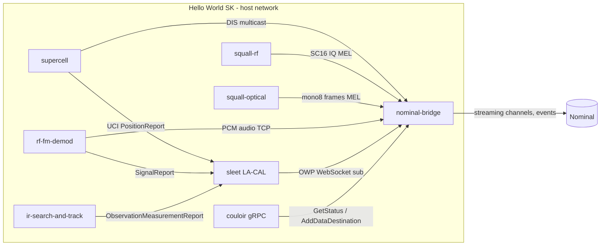

# AMS GRA Hello World SK → Nominal Integration

Streams every capturable output of the Open Arsenal **AMS GRA Hello World Starter Kit**
into [Nominal](https://nominal.io) live, and organizes it into a reviewable data model:
datasets, per-platform assets, runs, events, and time-synced sensor video. Built so AMS
GRA users can put their own sensors into the simulation and analyze the outputs alongside
real sensor test data in one place.

Everything here uses the public [Nominal Python SDK](https://docs.nominal.io/core/sdk/python-client)
(`pip install nominal`) only.

The sim itself is not in this repo. Instantiate it from
[open-arsenal/ams-gra/hello-world-sk/getting-started](https://gitlab.com/open-arsenal/ams-gra/hello-world-sk/getting-started)
(this repo's `compose.yaml` is a Docker translation of that bundle's podman deployment,
with the Nominal bridge added).

## What gets captured

See [CAPTURE_MATRIX.md](CAPTURE_MATRIX.md) for the full table: every output in the kit's
`docs/ports.md` registry, how it lands in Nominal, what raw form is preserved, and the
handful of interfaces that are deliberately not captured (with reasons).

## Architecture



Key integration mechanics:

- **OWP subscriber**: the bridge INITs against Sleet as its own authorized service
  (`sleet-services.d/nominal-bridge.toml`, bind-mounted into the sleet container) and
  subscribes to all 12 mission topics. No kit component is modified.
- **Raw MEL taps**: the bridge registers itself as a *second* UDP data destination on
  both Squall pipelines via the Couloir gRPC `AddDataDestination` call, so it receives a
  full copy of the raw sensor streams without interfering with the skills.
- **Streaming ingest**: SDK write streams (`dataset.get_write_stream()`), one per
  dataset, ~500 points/s total in the default scenario.

## How the data is structured in Nominal

### Datasets (one per stream family)

| Dataset | Content | Channel naming | Series tags |
|---|---|---|---|
| **AMS GRA - DIS Ground Truth** | Parsed EntityState PDUs | `dis.position.*`, `dis.velocity.*`, `dis.orientation.*`, `dis.entities_active` | `entity` (callsign: `Eagle-1`, `Bandit-1`, `Bandit-2`, `WOBR-953`) |
| **AMS GRA - UCI C2 Messages** | Flattened UCI messages | `uci.position.*`, `uci.ir_observation.*`, `uci.signal.*`, `uci.service_status.*`, `uci.subsystem_status.*`, `uci.system_status.*`, `uci.msg_total.*` | `entity`, `service`, `subsystem` (from message headers) |
| **AMS GRA - Raw Sensor Streams** | Derived sensor telemetry + video channels | `ir.frame.*`, `ir.target.*`, `rf.iq.*`, `rf.spectrum.*`, `audio.*`, `squall.ir.*`, `squall.rf.*`; video channels `ir.video.eagle1_nose`, `rf.video.spectrogram_915mhz` | `sensor` (`squall-ir` / `squall-rf`), `source` |
| **AMS GRA - Observability Metrics** | Scraped Prometheus metrics | `obs.<metric_name>` | `service` + the metric's own labels (e.g. `topic`) |

Channels use `.`-delimited names so they render as a prefix tree in the catalog. String
state channels (`uci.*_status.state`, `squall.*.mode`) are enum series; everything else
is numeric.

### Assets

- **Mission asset** — *AMS GRA Hello World Starter Kit*. Carries every dataset as a data
  scope: `dis_truth`, `uci_c2`, `raw_sensor`, `obs_metrics`, plus narrow tag-scoped refs
  (`uci_svc_ir`, `uci_svc_rf`, `uci_sub_ir`, `uci_sub_rf`, `obs_sleet`, `obs_supercell`,
  `obs_graupel`) so per-service state channels resolve to a single series.
- **Per-platform assets** — *Eagle-1*, *Bandit-1*, *Bandit-2*, *WOBR-953*, each scoping
  the shared datasets with `series_tags={"entity": <callsign>}`. This is the
  "each unit is an asset" pattern: one tagged dataset, many platform views. Eagle-1
  additionally scopes the UCI and raw-sensor data since it carries the sensors.

(Trivia from the kit source: all three aircraft fly the stock JSBSim Cessna 172P model;
the DIS entity type is category 84 "Civilian Fixed-Wing Single", subcategory 1
"Cessna 172".)

### Runs, events, attachments, video

- Each capture session is a **run** on the mission asset (created by `setup_nominal.py`).
- The bridge emits **events** on transitions: DIS entity appeared, IR track
  acquired/lost, FM signal acquired/lost, service/subsystem/system state changes, and
  sensor mode changes.
- Raw captures attach to the run: SC16 IQ snapshots with JSON provenance sidecars, DIS
  PDU binary logs, UCI JSONL logs, FM audio WAV segments, raw IR frames.
- Sensor video ingests as **dataset video channels** with true per-frame nanosecond
  timestamps, so scrubbing a chart cursor stays synced with the footage.

## Quickstart

Prerequisites: the Hello World SK images (public GitLab registry), Docker (or adapt to
podman), Python 3.11+ with `nominal`, `ffmpeg` for the video renderers, and a Nominal
profile (`~/.config/nominal/config.yml`).

```bash
pip install -U nominal

# 1. Create the Nominal resources and write RIDs + credentials into .env.
#    Default: find-or-create the four datasets by name.
python setup_nominal.py <your-nominal-profile>

#    Or map the streams onto datasets you already have (any subset):
python setup_nominal.py <profile> --ds-dis <rid> --ds-uci <rid> \
    --ds-sensor <rid> --ds-obs <rid>

# 2. Launch the sim + bridge:
docker compose up -d

# 3. Watch data arrive (channels appear in the catalog within ~2 minutes):
docker logs -f nominal-bridge

# 4. After capturing for a while, render + ingest sensor video and attach raw captures:
python render_ir_video.py <profile> $NOMINAL_DS_SENSOR
python render_waterfall.py <profile> $NOMINAL_DS_SENSOR
python attach_raw_captures.py <profile> $NOMINAL_RUN_RID
```

Notes:

- On macOS Docker Desktop, enable host networking; the squall containers run as uid
  1000 and need the shared socket volume writable (`chmod 0777` once).
- Encode ingest video with dense keyframes (the renderers here use 1 s GOPs); sparse
  keyframes make timeline scrubbing paint black between keyframes.
- The default scenario's `mission.route-plan` topic never publishes (the kit's own
  sleet service authorization for supercell omits it); the bridge subscribes anyway.

## Repository layout

| Path | Purpose |
|---|---|
| `compose.yaml` | Full sim + bridge deployment (Docker translation of the kit bundle) |
| `bridge/` | The nominal-bridge container: all seven taps + streaming + raw capture |
| `sleet-services.d/nominal-bridge.toml` | OWP service authorization for the bridge |
| `setup_nominal.py` | Creates or maps datasets, builds the asset model, opens a run; writes `.env` |
| `render_ir_video.py` | Raw IR frames → H.264 → Nominal video channel (true frame timestamps) |
| `render_waterfall.py` | IQ spectrogram waterfall → H.264 → Nominal video channel |
| `attach_raw_captures.py` | Attaches raw SC16/DIS/UCI/audio/IR captures to the run |
| `CAPTURE_MATRIX.md` | Authoritative output-by-output capture table |

## License

Apache-2.0. `bridge/squall_rf.proto` and `bridge/squall_ir.proto` are copied from
[open-arsenal/ams-gra/hello-world-sk/sensors/squall](https://gitlab.com/open-arsenal/ams-gra/hello-world-sk/sensors/squall)
(Apache-2.0) to generate the Couloir gRPC client.
