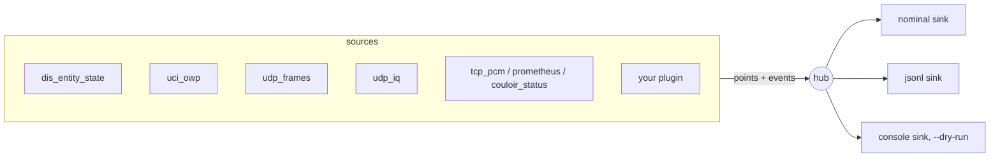

# Integrating your own setup

The bridge is one container driven by one YAML file. You describe where your data is,
and it streams to Nominal. You only write Python when a wire format isn't covered by a
built-in source, and that Python goes in a plugin file next to your config. The image
stays the same.

## How it fits together



A source reads one feed and emits points (`channel`, `timestamp`, `value`, `tags`) on a
named stream such as `dis` or `sensor`. The Nominal sink maps each stream to a dataset
RID. Sources run independently. If one crashes it restarts with backoff (2 s doubling
to 30 s) and the others keep going.

## First run on a new setup

1. Copy the template and fill in the lines marked `TODO`.

   ```bash
   cp configs/lab-template.yaml configs/my-lab.yaml
   ```

2. Check the file. This needs no network and no Nominal credentials. It reports every
   problem at once.

   ```bash
   docker compose -f compose.bridge.yaml run --rm nominal-bridge validate --offline
   ```

3. Dry run. The bridge connects to your sources and prints the first point of every
   channel plus a rate summary every 10 s. Nothing is sent to Nominal.

   ```bash
   docker compose -f compose.bridge.yaml run --rm nominal-bridge run --dry-run
   ```

   Add `--only dis-truth,rf-1` to bring sources up one at a time.

4. Create the Nominal datasets and assets from the `model:` section of the config, or
   map onto datasets you already have. RIDs and connection details land in `.env`.

   ```bash
   pip install ./bridge
   nominal-bridge provision -c configs/my-lab.yaml --profile <profile> --env-out .env
   nominal-bridge provision -c configs/my-lab.yaml --profile <profile> --env-out .env \
       --map dis=<existing dataset rid>
   ```

5. Start it.

   ```bash
   docker compose -f compose.bridge.yaml up -d
   docker logs -f nominal-bridge
   ```

`compose.bridge.yaml` mounts `configs/my-lab.yaml` by default. Point it somewhere else
with `BRIDGE_CONFIG_FILE=./configs/other.yaml`.

## What to change for common modifications

| You changed | Edit in the config | Code needed |
|---|---|---|
| IR/EO camera resolution or bit depth | `width`, `height`, `pixel_format` on the `udp_frames` source. With a `couloir:` block the size is read from the sensor. | None |
| Frames larger than one UDP datagram | `reassemble: true` | None |
| Frames over another transport | New source type | About 20 lines, see `examples/plugins/tcp_frames_source.py` |
| A real SDR instead of the simulated source | Nothing if it runs behind Squall RF: sample rate and centre frequency come from Couloir and retunes are followed. Otherwise set `sample_format`, `sample_rate_hz`, `center_frequency_hz`. | None |
| A second radio or camera | Add another source block with its own `name`, `port`, and `tags: {sensor: ...}` | None |
| A new skill publishing UCI | Add its message to `topics` and authorise the topic for `nominal-bridge` in Sleet's `services.d`. Fields arrive as `uci.<message>.*`. | None |
| You want specific channel names or events for that message | | A handler, see `examples/plugins/esm_activity_handler.py` |
| More or different entities in the truth feed | Nothing. Entities are discovered from the PDUs and tagged by marking. Use `max_entities` and `min_interval_s` to bound a busy picture. | None |
| DIS on another group, port or NIC | `group`, `port`, `interfaces` | None |
| ADS-B from a receiver | Enable the `adsb_sbs` source (BaseStation port 30003) | None |
| An adapter that can print JSON | `json_lines` source over UDP, TCP or a file | None |
| Different services to scrape | `endpoints` on the `prometheus` source | None |

Run `nominal-bridge types -v` for every source type with all its options and defaults.

## Source reference

| Type | Reads | Channels |
|---|---|---|
| `dis_entity_state` | DIS EntityState PDUs, multicast / broadcast / unicast | `dis.position.*`, `dis.velocity.*`, `dis.orientation.*`, `dis.force_id` per entity, plus `dis.entities_active`, `dis.pdu_total` |
| `uci_owp` | UCI JSON over the Sleet OWP WebSocket. Subscribe only. | Typed: `uci.position.*`, `uci.ir_observation.*`, `uci.signal.*`, `uci.*_status.*`, `uci.navigation.*`. Everything else: `uci.<message>.<field path>`. Counters: `uci.msg_total.<Message>` |
| `udp_frames` | Raw video frames (`mono8`, `mono16le`, `mono16be`, `rgb8`, `bgr8`) | `<prefix>.frame.*` (rate, intensity, saturation), `<prefix>.target.*` (bright-target centroid). Frames are recorded for video rendering. |
| `udp_iq` | Raw IQ (`sc16le`, `sc16be`, `sc8`, `cu8`, `cf32le`) | `<prefix>.iq.*` (level, clipping, delivery ratio), `<prefix>.spectrum.*`. Waterfall rows and periodic raw snapshots are recorded. |
| `tcp_pcm` | PCM audio from a TCP server | `<prefix>.rms_dbfs`, `.peak_dbfs`, `.active`. Rolling WAV segments are recorded. |
| `couloir_status` | Squall control plane over Couloir gRPC | `squall.ir.*`, `squall.rf.*` (mode, pointing, tuning, source type) |
| `prometheus` | `/metrics` endpoints | `obs.<metric>` tagged by service and the metric's labels |
| `adsb_sbs` | BaseStation (SBS-1) TCP feed | `adsb.*` per aircraft, tagged by `icao` |
| `json_lines` | One JSON object per datagram / line | `<prefix>.<field path>` |

Options every source accepts: `name` (unique), `type`, `stream`, `tags` (added to every
point), `enabled`.

`${VAR}` anywhere in the config is read from the environment and `${VAR:-default}`
supplies a fallback. A missing variable with no default fails validation by name.

## How generic UCI messages become channels

A message with no typed handler is flattened. Nested keys join with dots. A list of
objects keeps one channel per field and tells the elements apart with a tag named after
the list, so a report carrying five activities produces five series of
`uci.esm_activity.Activity.ActivityState` tagged `activity=0..4`, not five channel
names. UUIDs and timestamps are dropped unless you set `generic: {keep_ids: true}`.
`max_fields` (80) and `max_list_items` (16) bound one message's output.

Set `handlers: {SomeMessage: off}` to drop a message, or `generic` to bypass a typed
handler.

## Writing a plugin

Every `*.py` file in the plugins directory (`./plugins`, mounted at `/plugins`) is
imported at start-up. Check that yours loaded with `nominal-bridge types --plugins ./plugins`.

A UCI handler:

```python
from nominal_bridge import uci_handler

@uci_handler("ESM_Activity")
def esm_activity(msg, ctx):
    for act in msg.data.get("Activity", []):
        ctx.emit("uci.esm.activity_state", act["ActivityState"], ts_ns=msg.ts_ns,
                 tags={**msg.tags, "activity": act["ActivityID"]["UUID"][:8]})
```

`msg` gives you `name`, `header`, `data` (the `MessageData` object), `ts_ns` (from the
header timestamp), `tags` (system and service labels), `raw`, and `state`, a dict that
persists between messages for detecting changes.

A source:

```python
import asyncio
from nominal_bridge import Source, register_source

@register_source("my_sensor")
class MySensor(Source):
    DEFAULTS = {"stream": "sensor", "interval_s": 1.0}
    REQUIRED = ("host",)

    async def run(self):
        while True:
            value = await read_from(self.cfg["host"])
            self.ctx.emit("my_sensor.temperature_c", value)
            await asyncio.sleep(self.cfg["interval_s"])
```

`self.ctx` is the whole API a source needs:

| Call | Does |
|---|---|
| `ctx.emit(channel, value, ts_ns=None, tags=None, stream=None)` | Send one point. Numbers and strings are accepted, booleans become 0/1. Time defaults to now. |
| `ctx.event(name, type="INFO", description=None, properties=None)` | Create a Nominal event on the configured asset. Types are INFO, FLAG, ERROR, SUCCESS. |
| `ctx.presence(key, label, timeout_s)` | Call on every sighting. Raises `<label> acquired` once, then `<label> lost` after `timeout_s` of silence. |
| `ctx.log(...)` | Log line prefixed with the source name |
| `ctx.capture_dir` | Where to write raw recordings |

Raise an exception on a lost connection. The runner logs it and restarts the source.
To reuse the frame or IQ processing with a different transport, subclass `FrameSource`
or `IqSource` and implement `frames()` or `blocks()`.

## Protections you get by default

Events are throttled so a chatty source can't flood the timeline: the same event at
most once per 5 s and 30 per minute across the bridge (`events:` in the config).
Dropped events are counted in `bridge.events_dropped_total`.

Tag cardinality is capped where an outside feed controls it: `max_entities` on DIS,
`max_aircraft` on ADS-B, `max_series_per_endpoint` on Prometheus.

A malformed UCI message is counted in `uci.handler_errors_total` and skipped. A frame
of the wrong size is counted in `<prefix>.frame.size_mismatch_total` and the log says
what size was expected.

With `health: {stream: obs}` the bridge reports `bridge.source_up` and
`bridge.points_total` per source, so a dead feed is visible in Nominal.

## Squall destination slots

Check this before adding the bridge to a kit with extra skills.

Each Squall pipeline (RF, optical) can send to a fixed number of extra UDP destinations.
The number is the count of empty `[[sinks]]` entries in that pipeline's Squall config.
The stock `rf-simulated.toml` and `optical-simulated.toml` have two each:

```toml
[[sinks]]
name = "dynamic-udp-0"
type = "udp"
destinations = []
```

Every skill that consumes the pipeline takes one, and so does a bridge source with a
`couloir:` block. In the stock kit that's one skill plus the bridge, which fills both.

When all slots are taken, Squall doesn't refuse the next client. It gives it any slot
that is more than 60 s old, and whoever held that slot stops receiving data. We saw
this on the stock kit: a third client took the FM demod skill's slot and the skill
reported DEGRADED until the slot was released.

So count the consumers on each pipeline (your skills plus the bridge) and make sure the
Squall config has at least that many `[[sinks]]` entries. Adding one is four lines of
TOML and a Squall restart. If you can't change the Squall config, drop the `couloir:`
block from the bridge source, add a static destination for the bridge in the Squall
config, and set `sample_rate_hz` or `width`/`height` by hand.

What the bridge does on its side:

- It releases its slot on shutdown.
- If the sensor restarts, it notices within about 10 s and registers again.
- If its data stops while the sensor is still running, it logs that another client
  probably has its slot. It does not take the slot back, because that would disconnect
  someone else in turn.
- Run one bridge per kit.

## Podman

Everything here works with Podman, rootless included. Tested with Podman 6.2 and
podman-compose 1.6: the full kit plus the bridge, the DIS multicast feed, Couloir
registration, the image tarball, and plugins.

- `podman compose -f compose.bridge.yaml ...` works as written.
- On RHEL and other SELinux hosts, add `:Z` to bind mounts or the container can't
  read your config and plugins. That's the most likely first error, and it shows up as
  "config file not found" or a permission error.
- Without compose, the equivalent command is:

  ```bash
  podman run -d --name nominal-bridge --network host --restart on-failure \
    --env-file .env \
    -v ./configs/my-lab.yaml:/config/bridge.yaml:ro,Z \
    -v ./plugins:/plugins:ro,Z \
    -v nominal-bridge-capture:/capture \
    --log-opt max-size=20m \
    nominal-bridge:2.0.0
  ```

- `--network host` is required. It lets the bridge join the DIS multicast group and
  reach Sleet and Couloir on the addresses in the config.

## Networks without a route to Nominal

Build the image where you have internet and carry it over:

```bash
scripts/save-image.sh linux/amd64      # writes nominal-bridge-2.0.0-amd64.tar.gz
podman load -i nominal-bridge-2.0.0-amd64.tar.gz
```

If the lab can't reach Nominal at all, swap the sink for `jsonl` and the bridge records
every point to rotating files under `/capture/points`. If there is a TLS-inspecting
proxy in the path, set `trust_store_path` on the Nominal target to its CA bundle.

The bridge only makes outbound connections: HTTPS to the Nominal API, plus whatever
your sources name. It listens on the UDP ports you configure for frames and IQ.

## Trying it without a sim

`configs/replay.yaml` plays recorded DIS, UCI and IR captures from `tests/fixtures`
through the same sources:

```bash
pip install ./bridge
nominal-bridge run -c configs/replay.yaml --dry-run --capture-dir /tmp/capture
```

The DIS and UCI sources also accept `replay:` with a capture the bridge recorded
earlier (`/capture/dis_raw`, `/capture/uci_raw`), which is useful for developing a
handler against real traffic from your lab. `replay_timestamps: now` shifts the
recording to the present.

## Tests

```bash
pip install -e "./bridge[dev]"
pytest tests
```
